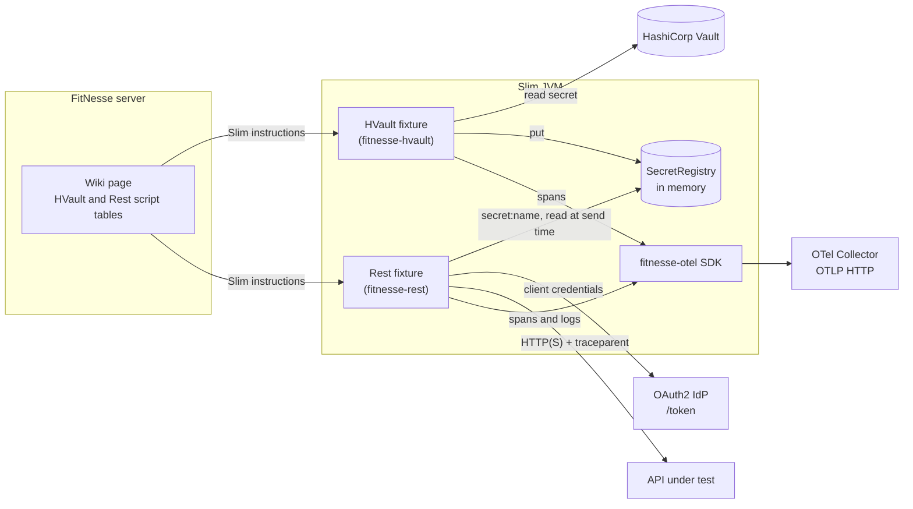
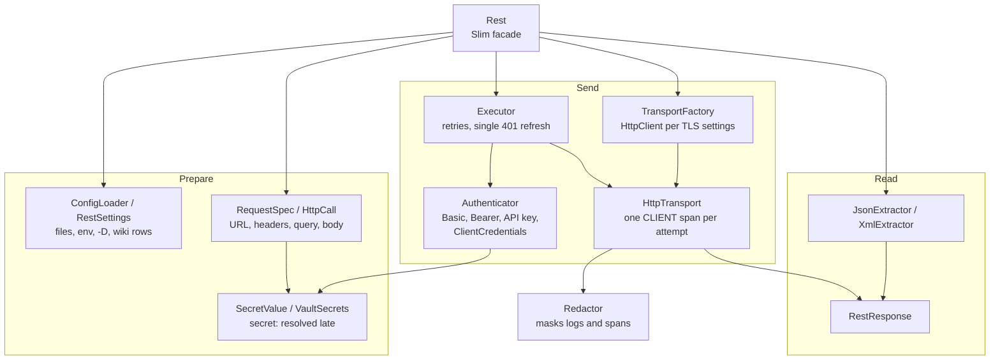
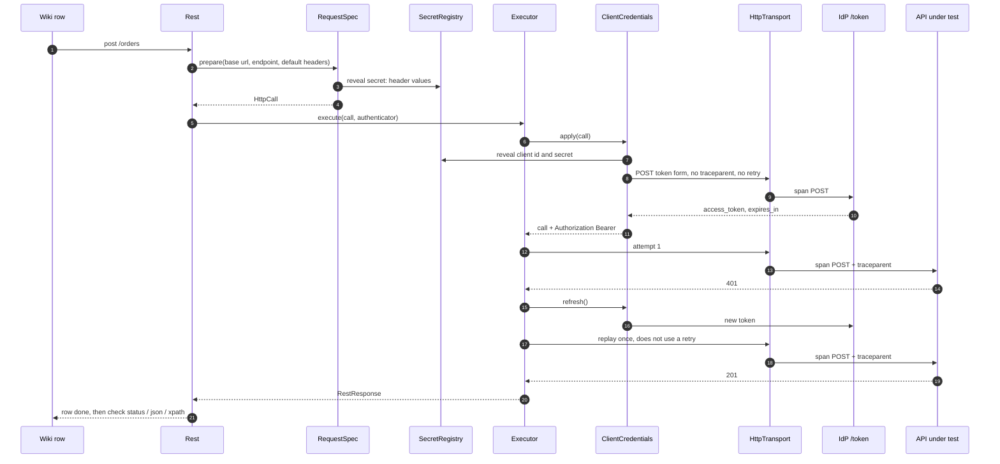
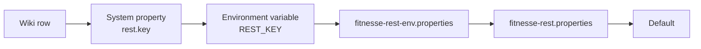
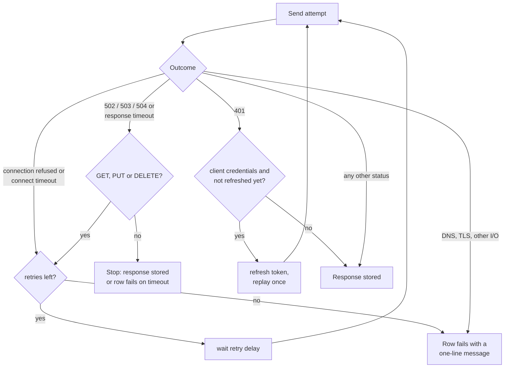
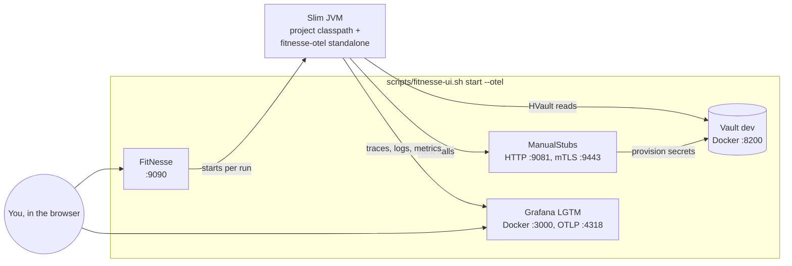

# fitnesse-rest

A generic REST client fixture for FitNesse Slim **script tables**. Test teams call and assert HTTP APIs
(microservices, payment gateways, ESBs) from wiki pages, without writing one fixture per test case:

- `GET`, `POST`, `PUT`, `PATCH`, `DELETE` with headers, query parameters and a text body (JSON, XML, any text);
- one configuration file per environment;
- Basic, Bearer, API key (header or query parameter) and OAuth2 client credentials authentication;
- keystore / truststore files (PKCS12, JKS), PEM certificates from the `fitnesse-hvault` registry, SSL bypass;
- retries on transient failures and a token refresh on `401`;
- checks on status, body and headers, JsonPath and XPath extraction into checks and Slim symbols;
- one OpenTelemetry `CLIENT` span per HTTP attempt, with W3C `traceparent` propagation.

Secrets can be written as `secret:<variable>` references to the in-memory registry filled by
`fitnesse-hvault`; they are never put in messages, logs or spans.

## How it works

The fixtures run inside the Slim JVM that FitNesse starts for a test. `HVault` (optional) copies secrets from Vault
into an in-memory registry; `Rest` reads them through `secret:` references while it builds each request, calls the
API under test and exports its telemetry through `fitnesse-otel`.



### Inside the fixture

`Rest` only maps wiki rows to calls; each component below has one job and is unit-tested on its own.



### One request, step by step

A `|post|/orders|` row with OAuth2 client credentials and `max retries` = 1:



## Maven coordinates

```xml
<dependency>
  <groupId>io.github.tortaje</groupId>
  <artifactId>fitnesse-rest</artifactId>
  <version>1.0.0-SNAPSHOT</version>
</dependency>
```

Java 17+, FitNesse `20260313`. The jar embeds Jayway `json-path` and its dependencies, relocated under
`io.github.tortaje.rest.shaded` (licenses in `META-INF/THIRD-PARTY-LICENSES.txt`). It does not embed FitNesse,
`fitnesse-hvault`, `fitnesse-otel` or OpenTelemetry.

## FitNesse setup

`fitnesse-otel` is **required** on the `!path`; `fitnesse-hvault` is **optional** (needed only by pages that use
`secret:` references, `use mtls` or `trust ca`). The `conf` directory holds the configuration files.

```
!path lib/fitnesse-otel-*-standalone.jar
!path lib/fitnesse-hvault-*.jar
!path lib/fitnesse-rest-*.jar
!path conf
```

Without `fitnesse-hvault`, a page that uses a secret reference fails with
`Secret reference used but fitnesse-hvault is not on the !path`; other pages work.

## Configuration

### Files

- `fitnesse-rest.properties`: common values (optional).
- `fitnesse-rest-<env>.properties`: values of one environment; they override the common file.

Both are read from the classpath (typically `conf` on the `!path`). `<env>` is the constructor argument
(`|script|Rest|uat|`), else the `REST_ENV` environment variable, else none. A named environment whose file is
missing fails at construction.

### Keys

| Key | Default | Wiki equivalent |
|---|---|---|
| `base_url` | none | `base url` |
| `timeout_seconds` | `30` | `timeout` |
| `max_retries` | `0` | `max retries` |
| `retry_delay_ms` | `500` | `retry delay` |
| `ignore_ssl_errors` | `false` | `ignore ssl errors` |
| `keystore_path`, `keystore_password` | none | `keystore` |
| `truststore_path`, `truststore_password` | none | `truststore` |
| `token_url`, `client_id`, `client_secret`, `default_scope` | none | `token url`, `client credentials`, `scope` |
| `default_headers.<Name>` | none | — (overridden by `header`) |
| `max_response_bytes` | `16777216` (16 MiB) | — |

Setting `client_id` and `client_secret` activates client credentials by default; a wiki authentication row
replaces it. `timeout_seconds` is used for both the connect and the response timeout.

### Precedence



Highest first: wiki row → system property `rest.<key>` → environment variable `REST_<KEY>` (upper case, `.`
replaced by `_`) → environment file → common file → default.

`default_headers.<Name>` entries come from the files and from system properties
(`rest.default_headers.<Name>`) only; environment variables are not scanned for header names.

Example `conf/fitnesse-rest-uat.properties`:

```properties
base_url=https://api.uat.example.com
token_url=https://idp.uat.example.com/token
client_id=secret:clientId
client_secret=secret:clientSecret
default_headers.Accept=application/json
timeout_seconds=10
max_retries=2
```

## Wiki vocabulary

Slim builds the method name from the odd cells; even cells are arguments. A **multi-argument row** therefore
ends its action name with `;` — `|header;|name|value|` — which tells Slim that every following cell is an
argument. Single-argument rows need no `;`.

URL cells (`base url`, `token url`, endpoints) may be written plainly: FitNesse turns them into links, and the
fixture strips that markup (and its `&amp;` / `&lt;` / `&gt;` entities) back to the URL you wrote.

### Constructor

| Row | Effect |
|---|---|
| `\|script\|Rest\|` | Loads the common configuration file only. |
| `\|script\|Rest\|uat\|` | Loads the common file, then `fitnesse-rest-uat.properties`. |
| `\|script\|` | Continues with the previous `Rest` instance (same configuration, same token). |

### Target and transport

| Row | Effect |
|---|---|
| `\|base url\|https://…\|` | Base URL. An absolute endpoint ignores it. |
| `\|timeout\|30\|` | Seconds, for connect and response timeouts. |
| `\|max retries\|2\|` | Retries after the first attempt. |
| `\|retry delay\|500\|` | Fixed delay between attempts, in ms. |
| `\|ignore ssl errors\|true\|` | Trusts any certificate and skips hostname verification; logs a WARN. Cannot be combined with `use mtls`. |
| `\|keystore;\|certs/client.p12\|pwd\|` | Client certificate from a file (PKCS12 or JKS, detected). |
| `\|truststore;\|certs/ca.jks\|pwd\|` | Trusted CAs from a file. |
| `\|use mtls;\|mtls.cert\|mtls.key\|mtls.ca\|` | Client certificate from registry PEMs; the CA cell may be empty (JVM truststore). |
| `\|trust ca\|mtls.ca\|` | Trusted CA from a registry PEM, no client certificate. |

`use mtls` and `trust ca` take **registry variable names**, without the `secret:` prefix.

### Authentication

Exactly one mode is active; the last row wins.

| Row | Effect |
|---|---|
| `\|basic auth;\|user\|pwd\|` | `Authorization: Basic base64(user:pwd)` (UTF-8). |
| `\|bearer token\|tok\|` | `Authorization: Bearer tok`. |
| `\|api key header;\|X-API-Key\|val\|` | Header carrying the key. |
| `\|api key param;\|api_key\|val\|` | Query parameter carrying the key. |
| `\|client credentials;\|id\|secret\|` | OAuth2 client credentials. |
| `\|token url\|https://idp…/token\|` | IdP token endpoint for client credentials. |
| `\|scope\|payments.write\|` | Scope sent to the IdP (optional). |
| `\|no auth\|` | Disables authentication. |

Client credentials: `POST token_url` with a form body `grant_type=client_credentials&client_id=…&client_secret=…
[&scope=…]`; `access_token` and `expires_in` are read from the response. The token is cached in the `Rest`
instance only (so typically one IdP call per page when later tables use `|script|`), renewed when less than
30 s of validity remain or after a `401`. The IdP call is never retried and carries no `traceparent`.

### Request

| Row | Effect |
|---|---|
| `\|header;\|name\|value\|` | Adds a header; overrides a `default_headers` entry of the same name. |
| `\|query param;\|name\|value\|` | Adds a URL-encoded query parameter. |
| `\|body\|text\|` | Request body. |
| `\|body from file\|payloads/pacs008.xml\|` | Body read from a UTF-8 file, relative to the FitNesse working directory. |
| `\|reset\|` | Clears headers, query parameters and body; keeps configuration, TLS and authentication. |

### Actions

`|get|/path|`, `|post|/path|`, `|put|/path|`, `|patch|/path|`, `|delete|/path|`

- The endpoint is appended to the base URL unless it is absolute (`http://…` / `https://…`).
- The URL must have an `http` or `https` scheme and a valid host; otherwise the row fails with
  `Invalid URL for endpoint '/path'`.
- Any HTTP status is a normal outcome, asserted with `check status`; only technical failures raise an exception.
- After each send, successful or not, body and query parameters are cleared; headers stay until `reset`.

### Response

| Row | Returns |
|---|---|
| `\|check\|status\|201\|` | Final HTTP status code. |
| `\|show\|body\|`, `\|check\|body\|…\|` | Raw response body. |
| `\|show\|pretty body\|` | Collapsible block in the page: the summary shows status, content type and size (`· truncated` when cut); expanded, the payload is indented (JSON, XML) and escaped. Display is limited to 64 KB. |
| `\|ensure\|response contains\|ACCEPTED\|` | `true` if the body contains the text. |
| `\|check\|response header\|Content-Type\|application/json\|` | Header value (case-insensitive name); several values joined with `, `; missing header: empty. |
| `\|check\|json\|$.status\|ACCEPTED\|` | JsonPath result: scalar as text, object or array as JSON. |
| `\|$id=\|json\|$.id\|` | Same, stored into a Slim symbol. |
| `\|check\|xpath\|/Document/GrpHdr/MsgId\|M1\|` | Text of the first matching node (namespace-unaware; DTDs and external entities disabled). |

A JsonPath or XPath that matches nothing raises `JsonPath '…' not found in response` / `XPath '…' not found in
response` (no silent `null`). The body is parsed once per response, whatever the number of checks.

Bodies larger than `max_response_bytes` keep only their beginning: `status`, headers and `body` still work, a WARN
is logged, and `json` / `xpath` fail with `Response body is truncated: raise max_response_bytes to extract from it`.
The body is decoded with the `charset` of `Content-Type` (UTF-8 by default).

## Example pages

Standalone (plain values; configuration in `conf/fitnesse-rest-uat.properties`):

```
|import|
|io.github.tortaje.rest|

|script|Rest|uat|
|keystore;|certs/client.p12|changeit|
|client credentials;|my-app|s3cr3t|
|header;|Content-Type|application/json|
|body|{"amount": 100, "currency": "EUR"}|
|post|/payments|
|check|status|201|
|$id=|json|$.id|

|script|
|get|/payments/$id|
|check|json|$.status|ACCEPTED|
```

With `fitnesse-hvault` (secrets read from Vault into the registry, then referenced):

```
|import|
|io.github.tortaje.hvault|
|io.github.tortaje.rest|

|script|HVault|
|read secret|fitnesse/oauth|key|client_id|into|clientId|
|read secret|fitnesse/oauth|key|client_secret|into|clientSecret|
|read all secrets from|fitnesse/mtls|with prefix|mtls.|

|script|Rest|uat|
|use mtls;|mtls.cert|mtls.key|mtls.ca|
|client credentials;|secret:clientId|secret:clientSecret|
|header;|Content-Type|application/json|
|body|{"amount": 100, "currency": "EUR"}|
|post|/payments|
|check|status|201|
|$id=|json|$.id|

|script|
|get|/payments/$id|
|check|json|$.status|ACCEPTED|
```

## Secrets

- A cell or configuration value written `secret:<variable>` is read from the `fitnesse-hvault` registry when the
  request is built, never earlier. The fixture never writes to or clears the registry.
- Accepted in the wiki: `basic auth` (user, password), `bearer token`, `api key header` and `api key param`
  (value), `client credentials` (id, secret), `keystore` / `truststore` (password), `header` (value).
- Accepted in configuration: `client_id`, `client_secret`, `keystore_password`, `truststore_password` and
  `default_headers.<Name>`. Plain values are accepted (standalone mode); shared-Vault campaigns should use only
  `secret:` references.
- Logs, spans and fixture messages never contain a secret or a query string. Headers `Authorization`,
  `Proxy-Authorization`, `Cookie`, `Set-Cookie`, the API-key header and every header whose value is a `secret:`
  reference are masked as `****` in logs. IdP request and response bodies are never logged.
- Response data (`show body`, `response header`) is returned as is: it is business data.
- Credentials (Basic, Bearer, API key, OAuth2 token) are only sent to the **origin of the base URL** (scheme, host,
  port). An absolute endpoint on another origin — typed by mistake or taken from a response into a symbol — is
  called without them, with a WARN `Credentials not sent to <origin>: not the base url origin`. Without a base URL,
  every endpoint is absolute and credentials follow it.
- Credentials sent over plain `http` to a host other than the loopback interface log a WARN once per origin.
- Messages never show the userinfo (`user:password@`) of a URL.

## Retry policy



| Attempt outcome | Decision |
|---|---|
| Connection refused or connect timeout (request never sent) | Retried for **any method**, within `max retries`. |
| Status `502`, `503`, `504`, or no response before the timeout | Retried only for `GET`, `PUT`, `DELETE`; never for `POST` / `PATCH`. |
| `401` with client credentials | Token refreshed and the request replayed **once**; does not consume `max retries`. |
| Unknown host (DNS), TLS handshake failure, other I/O errors | Not retried: the row fails. |
| Any other status (`400`, `404`, …) | Not retried; the response is stored. |

`retry delay` is waited between attempts; a retried request is sent again with the same body. With the
defaults (`max_retries=0`) nothing is retried.

## Errors, logs and traces

- Technical failures show one sentence in the cell, for example
  `POST api.uat.example.com/payments: no response after 30 s (3 attempts)` or
  `GET api.uat.example.com/x: TLS handshake failed (PKIX path building failed)`.
- `java.util.logging`, logger `io.github.tortaje.rest`: INFO one line per attempt
  (`POST https://host/path -> 201 (142 ms)`), FINE redacted headers and business request body, WARN for the
  SSL bypass.
- OpenTelemetry (through `fitnesse-otel`): one `CLIENT` span per attempt named after the method, with
  `http.request.method`, `url.full` (without query), `server.address`, `server.port`,
  `http.response.status_code`, `http.request.resend_count` and `error.type`.

## Building

```
mvn clean verify
```

Runs the unit and stub-server tests, the telemetry tests (`*SpanTest`), the tests without `fitnesse-hvault`
(`*NoHvaultTest`), the FitNesse suite in `src/test/fitnesse` and a check of the packaged jar (`PackagedJarIT`).

```
mvn clean verify -Pit
```

Also runs `RestVaultIT` (needs Docker): a real Vault started with Testcontainers holds the OAuth client, an API key
and mTLS PEMs; the `RestVaultSuite` wiki pages read them with the `HVault` fixture and use them through `secret:`
references in JSON (order CRUD), XML (pacs.008 / pacs.002), API key + retry, OAuth2 401 refresh and mTLS scenarios
against stub endpoints. Results: `target/fitnesse-results/RestVaultSuite.*.html`. A `VAULT_ADDR` set in the
environment takes precedence over the container address in the HVault fixture: unset it before running.

To run the suite by hand from the FitNesse UI (Vault in Docker, stub endpoints, FitNesse on port 9090):

```
scripts/fitnesse-ui.sh start          # or: start --otel  (adds Grafana LGTM on http://localhost:3000)
scripts/fitnesse-ui.sh stop
```



With `--otel`, the Slim JVM loads the `fitnesse-otel` standalone SDK and exports traces, logs and JVM metrics to the
LGTM collector (`service.name=fitnesse-rest`, one `test.run.id` per start). Each HTTP call is its own trace; the stub
log `target/fitnesse-ui/stubs.log` prints the `traceparent` each request carried.
